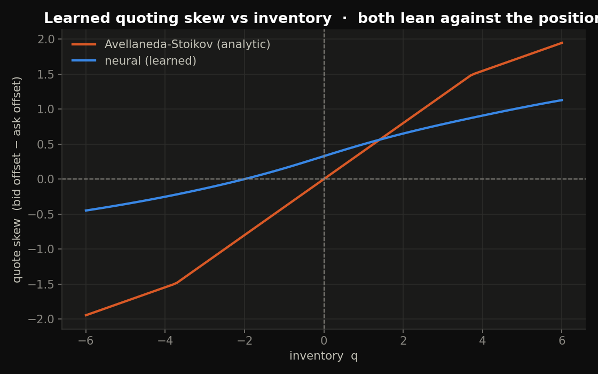
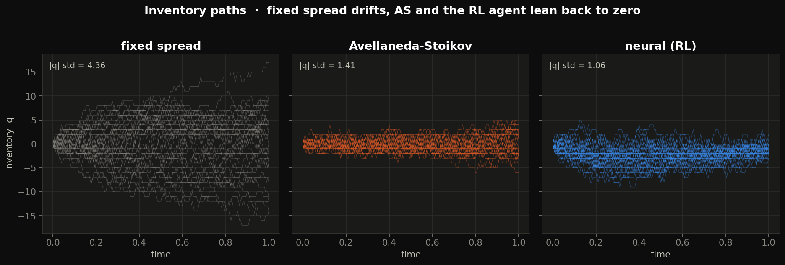
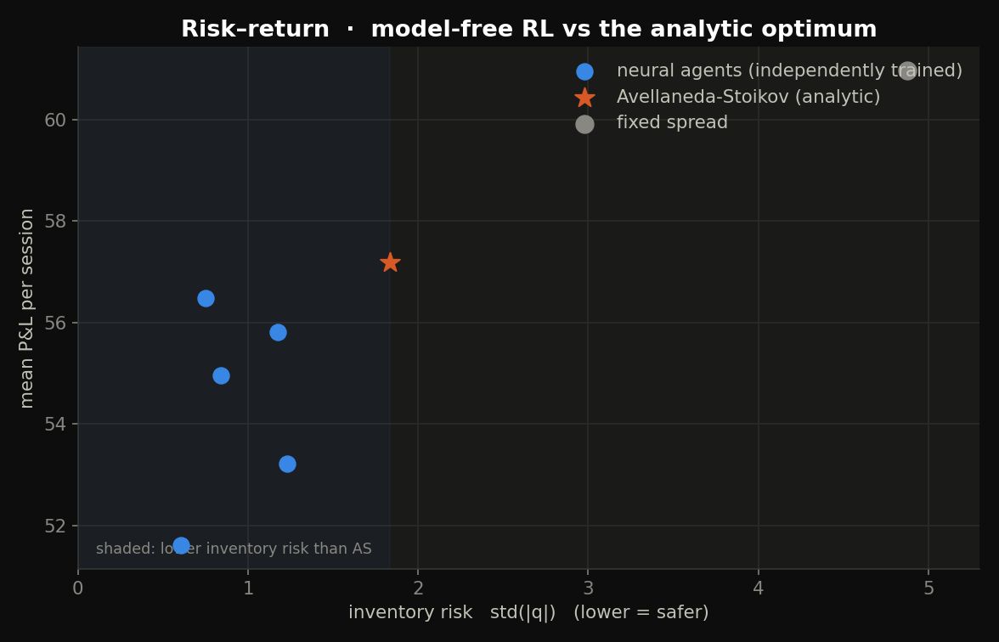
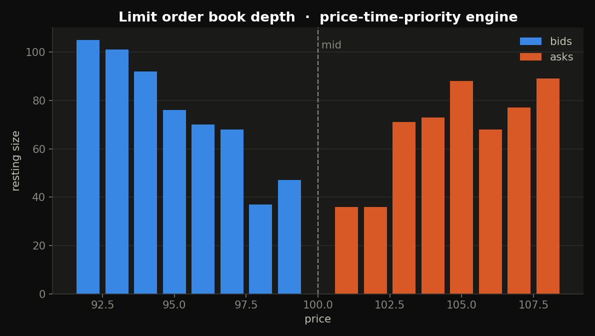
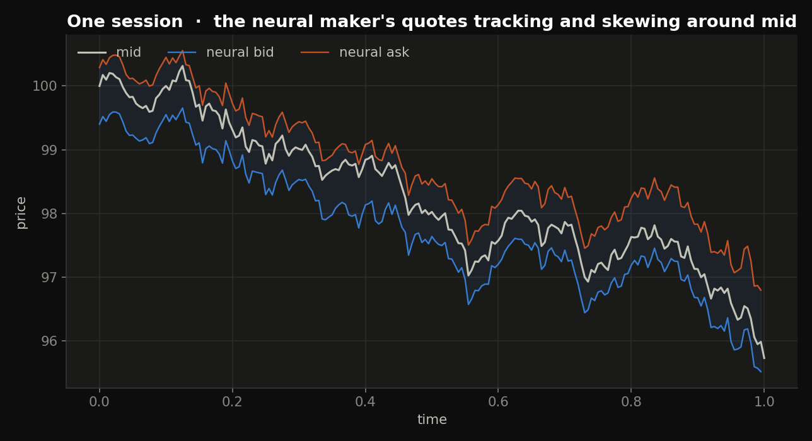
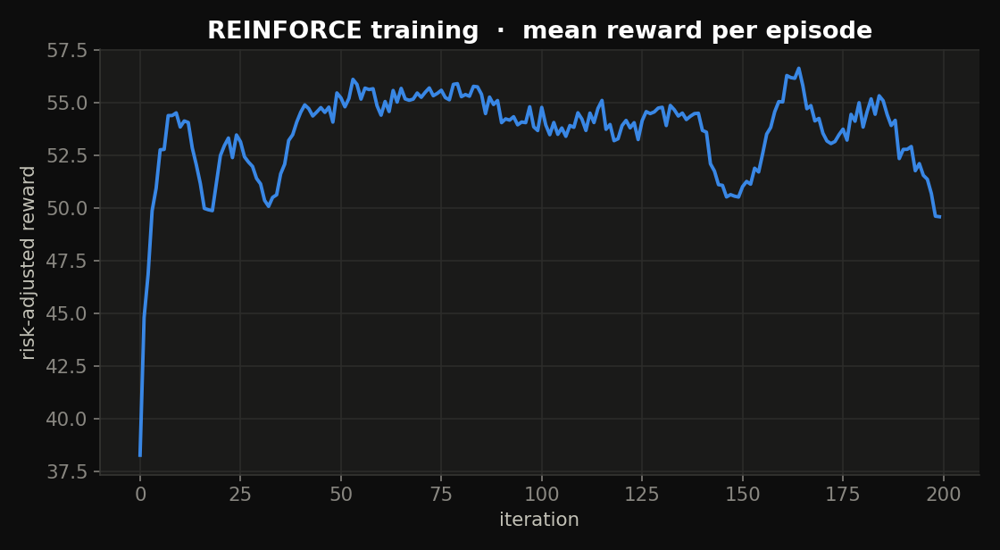
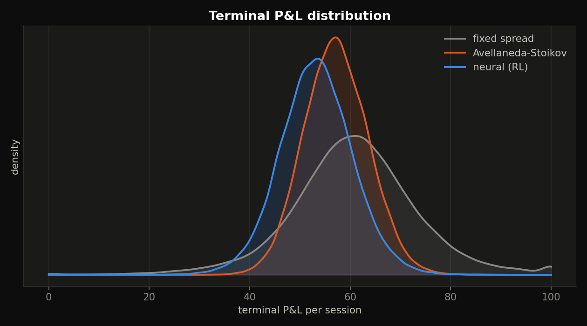

# deepmm


**Deep Market Making** — a neural market-making agent that learns to quote bid/ask
spreads by **reinforcement learning**, benchmarked against the closed-form
**Avellaneda–Stoikov** optimal maker, quoting into a real **limit-order-book
matching engine**.

The headline result: a *model-free* agent, given only rewards, independently
learns the same **inventory-leaning quoting** that Avellaneda–Stoikov derive in
closed form — and controls inventory even more tightly.



The analytic AS skew is a straight line through the origin (lean harder against
bigger inventory). The RL agent recovers the same structure from scratch — with a
sensible *bounded* refinement at extreme inventory that the linear rule lacks.

## Why this is a step up

Market making is a harder control problem than hedging: you quote **both sides**,
you're **adversely selected** (you buy just before the price drops), and you carry
**inventory risk** the whole session. And the environment — discrete fills, a
random mid — **is not differentiable**, so you can't backprop through it the way
deep hedging does. This uses **REINFORCE** (policy-gradient) instead, with the
score-function gradient supplied by the same from-scratch autodiff engine.

## Inventory control is the whole game

A fixed spread accumulates a huge directional position; AS and the RL agent lean
their quotes to pull inventory back to zero:



| strategy | mean P&L | P&L std | inventory risk `std(\|q\|)` |
|----------|---------:|--------:|---------------------------:|
| fixed spread | 60.97 | 12.93 | 4.88 |
| Avellaneda–Stoikov | 57.19 | 6.40 | 1.83 |
| **neural (RL)** | 52–57 | ~7 | **0.6–1.4** |

The RL agents sit at **lower inventory risk than AS** across risk-aversion
settings, for a modest give-up in mean P&L — the honest risk-return picture:



*(No overclaim: AS is the analytic optimum for its objective; the RL agent isn't
strictly better, it trades a little mean P&L for materially lower inventory risk,
model-free.)*

## The method

- **Market model** — mid-price is arithmetic Brownian motion; a quote at distance
  δ from mid is hit by a market order with intensity `λ(δ) = A·exp(−κδ)`
  (tighter quotes fill more often). A bid fill means we buy (inventory up), an ask
  fill means we sell.
- **Avellaneda–Stoikov (2008)** — the risk-averse optimum: quote around a
  *reservation price* `r = s − q·γσ²(T−t)` that leans against inventory `q`.
- **The RL agent** — a policy network maps `[inventory, time-left]` to mean quote
  offsets; actions are sampled, and the policy is updated by REINFORCE toward
  actions that earned above-average **risk-adjusted reward**
  `P&L − η·Σ q²Δt`. The inventory penalty `η` is the risk-aversion knob.
- **Order book** — a real price-time-priority matching engine (`lob.py`) turns
  quotes into fills, with queues and level-walking.

## How it's built (and verified)

| File | What it is | Verified by |
|------|------------|-------------|
| `autodiff.py` | reverse-mode autodiff over NumPy | finite-difference gradient check |
| `lob.py` | limit order book, price-time priority | matching/priority unit tests |
| `market.py` | mid + fill-intensity model, AS closed form | AS beats fixed on inventory risk |
| `agents.py` | fixed / AS / neural agents, REINFORCE | neural learns inventory control |
| `run.py` | trains everything, renders the figures | — |

## Run it

```sh
git clone https://github.com/b17w1z4rd/deepmm.git
cd deepmm
pip install numpy scipy matplotlib

python3 lob.py        # order-book engine tests
python3 market.py     # AS vs fixed spread
python3 agents.py     # train the RL maker, compare to AS
python3 run.py        # train + render all 7 figures  (--retrain to recompute)
```

`run.py` trains one agent per risk-aversion level and caches to
`figures/cache.npz` (~4–5 min, pure NumPy); re-run to redraw instantly.

## Figure gallery

| | |
|---|---|
|  |  |
|  |  |

## Notes & scope

- Simulated microstructure (AS intensity model), fully reproducible with no data.
- REINFORCE is high-variance; the frontier is drawn from independently trained
  agents, so expect run-to-run scatter (visible in the frontier plot).
- The order-book engine is the realistic execution layer and the source of the
  depth visual; the statistical comparison runs on the AS intensity model AS is
  defined on.

## Roadmap

- [ ] Train directly against the LOB engine with queue-position-aware fills
- [ ] Add an informed-trader flow so the maker faces real adverse selection
- [ ] Actor–critic (a learned value baseline) to cut REINFORCE variance
- [ ] Multi-level quoting (size across several price levels)

## References

- Avellaneda & Stoikov — *High-frequency trading in a limit order book*
  (Quantitative Finance, 2008)
- Guéant, Lehalle, Fernandez-Tapia — *Dealing with the inventory risk* (2013)

## License

MIT — see [LICENSE](LICENSE).
